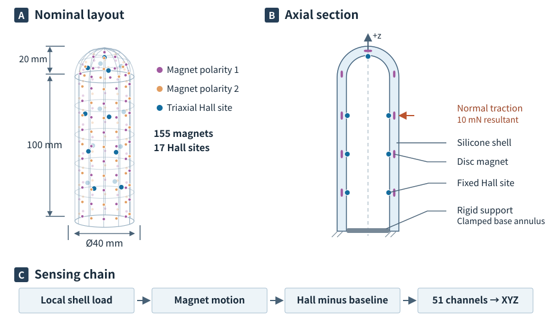
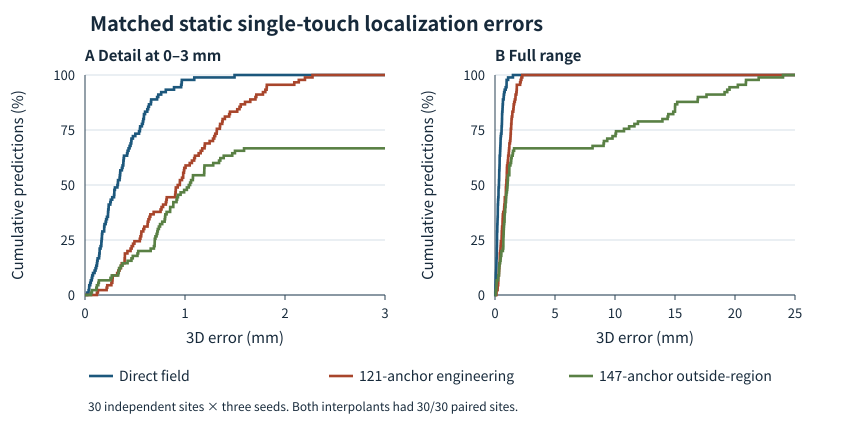
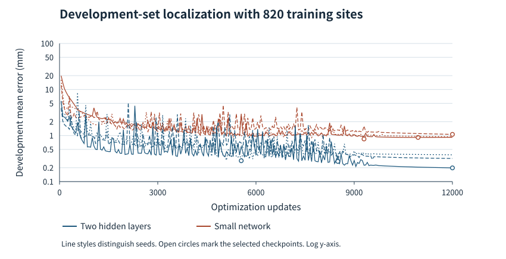
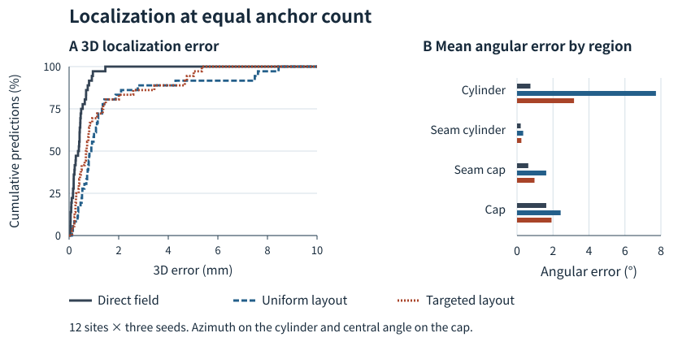
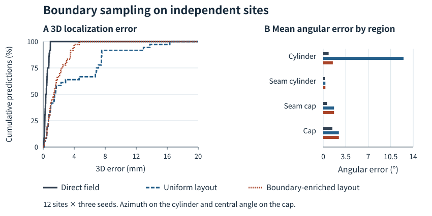
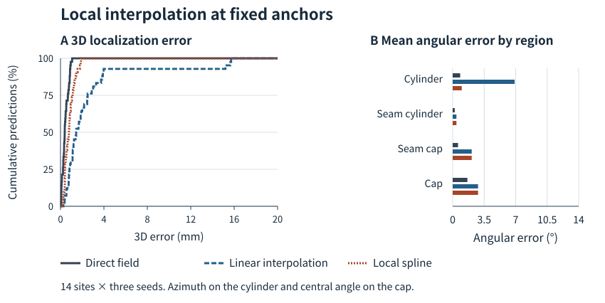

# Single touch localization and sparse magnetic field reconstruction on a cylinder with a hemispherical cap

## Abstract

Localizing touch on a curved surface from a finite set of magnetic anchors introduces error through both the inverse model and field reconstruction at unsampled sites. We model a cylindrical shell with a hemispherical cap under a fixed 10 mN normal resultant and Gaussian width of 12 mm. Differential readings from 17 triaxial Hall sensors provide the inputs for three-dimensional localization. A crossed comparison on 30 independent sites isolates field input and model configuration. Additional matched cohorts separate the effects of anchor layout and interpolation. With directly computed fields, the two-hidden-layer model achieved a mean 3D error, RMSE and P95 of 0.375, 0.463 and 0.929 mm. The P95 was 1.817 mm with engineering interpolation and 19.925 mm with outside-region anchors. At an unchanged budget of 147 anchors, boundary-oriented placement reduced P95 from 13.142 to 3.877 mm on 12 new sites. On a disjoint set of 14 sites using the selected layout, local thin-plate splines reduced P95 from 14.633 to 1.774 mm. A further ten sites in the cylindrical transition zone met the registered noninferiority margins for localization and field error, with exact recovery of linear interpolation at the upper end. The evidence distinguishes inverse accuracy from the quality and support of the reconstructed field in static single-touch simulation.

Keywords: magnetic touch, curved surface localization, finite elements, periodic interpolation, thin-plate splines

## 1　Introduction

Soft magnetic touch reads contact-induced motion of magnets or magnetic media through a small array of field sensors. Studies of position and force decoupling, continuous magnetic skins and transfer across replaceable sensor instances illustrate how mechanical design and signal interpretation interact [1–3,5–8]. A semi-cylindrical prototype has demonstrated discrete contact localization [4]. A continuous sidewall joined to a hemispherical cap raises a further question: how well can an inverse map recover three-dimensional position from finite field observations across different curvatures and near the seam? In simulation-assisted design, a finite budget also requires reconstruction between directly computed field anchors. End-to-end errors alone conflate imperfections of the inverse map and those of the reconstruction.

We ask how much a two-hidden-layer model improves localization relative to a compact network and template matching on identical sites and signals, and how that advantage changes with interpolated fields. We then ask whether boundary-oriented placement and local interpolation improve tail errors at fixed anchor count without degrading the seam or cap. All comparisons pair coordinates, loads and channel order. The results are organized by the factor controlled, with each cohort retaining its own denominator.

## 2　Methods

### 2.1　Sensor architecture and sensing principle

The sensing surface of MagTouch combines a cylindrical sidewall with a hemispherical cap (Fig. 1). The outer diameter is 40 mm, the straight cylinder is 100 mm high, and the cap has an outer radius of 20 mm, giving an overall height of 120 mm. A contact can be placed on the sidewall, near the seam or on the cap. The basal annulus provides the mounting and constraint boundary. The estimation target is the three-dimensional position of a single static contact on the unloaded outer surface, defined as the center of applied traction in the forward model. The normal resultant is fixed at 10 mN for comparing field signatures and localization errors across sites.

The cross section comprises a deformable silicone shell, embedded disc magnets and an internal, rigidly supported Hall sensing layer. The reference inner radius is 14 mm. The 155 magnets measure 5 mm in diameter and 1 mm in thickness. Their centers lie on a nominal concentric surface of radius 17 mm. The sidewall has ten rings of 12 magnets at 10 mm increments from z=5 to 95 mm. Three cap rings have 16, 12 and 6 magnets, plus one at the apex. The magnetization axes follow the local surface normals, with checkerboard polarity. The magnets are perfectly bonded to the silicone and modeled as rigid bodies that translate and rotate by small angles as the shell deforms.

The Hall observation sites lie inside the inner wall on a nominal concentric surface of radius 13.4 mm. An ideal rigid support holds their positions and reading axes fixed. On the sidewall, four equally spaced sites are placed at each of z=25, 50 and 75 mm, with starting azimuths of 0°, 22.5° and 45°, respectively. The cap adds four sites at a polar angle of 60° and one at the apex, giving 17 triaxial sites in total. The polar angle is measured from +z. Contact-induced magnet translations and rotations change the triaxial fields at multiple fixed Hall sites. The unloaded readings are subtracted and the signed differences are concatenated in a fixed order into 51 channels. The inverse model estimates the surface contact location from these differences.

Figure 1 uses the frozen nominal magnet and Hall coordinates. The rigid support in the section schematic denotes the model boundary condition. It does not specify a fabrication or mounting process. The forward model uses 184,388 curved tetrahedra and a mixed P2/P1 discretization. The following equations relate applied traction to mechanical response and Hall readout.

Figure 1. Simulated architecture of the cylinder–hemisphere sensor.. A, nominal magnet and Hall locations, with back-side markers faded. B, axial section with schematic magnets and rigid support. C, the readout chain from shell loading to 3D localization.

#### Traction and elasticity

On the unloaded surface Γ, s is the prescribed site and n is the outward normal. The scale a(s) is recomputed so that the traction resultant projected onto the inward contact axis is F₀=0.01 N, with σ=12 mm. This load footprint defines a controlled numerical boundary condition.

The reduced coordinates q collect free nodal displacements and rigid-body motions of the 155 inclusions. T is the constraint transform, and p enforces the discrete volumetric constraint. K, B and M are the shear stiffness, dilatational coupling and pressure mass matrices. The basal annulus is clamped. The archived reference elasticity uses E=1 MPa and ν=0.49 with μ=E/[2(1+ν)] and λ=Eν/[(1+ν)(1−2ν)]. Inclusion displacements use translations and infinitesimal rotations. The conclusions apply in the small-strain and small-rotation regime.

(1)  t(X;s) = −a(s) exp[−‖X−s‖²/(2σ²)] n(X),   ∫Γ t · [−n(s)] dA = F₀.

(2)  [ μK  Bᵀ ; B  −M/λ ] [q ; p] = [Tᵀf ; 0].

#### Magnetic observations

At Hall position Xᵢ, each finite-cylinder field b_c is rotated into global coordinates and expressed in the local Hall frame Qᵢ. The magnet center and rotation are c and R, superscript 0 marks the unloaded configuration, and sⱼ is its checkerboard polarity. The 51 signed channels are in µT/T, normalized to magnetic polarization. Exterior fields are evaluated with the finite-cylinder operator and a numerically stable near-axis expansion where applicable [9].

(3)  Δbᵢ = Qᵢᵀ Σⱼ sⱼ [Rⱼ b_c(Rⱼᵀ(Xᵢ−cⱼ)) − Rⱼ⁰ b_c((Rⱼ⁰)ᵀ(Xᵢ−cⱼ⁰))].

### 2.2　Inverse model, periodic interpolation and evaluation protocol

#### Shared inputs and prediction target

Each inference uses one static 51-component signed differential magnetic field. The three local-axis readings from each of the 17 fixed Hall sensors are concatenated in a fixed sensor order. Each reading is the loaded field minus its unloaded reference. Direct fields use the archived order-96 quadrature, and interpolated fields retain the same sensor and component ordering. All three methods output a Cartesian surface contact position in mm. The load is fixed at a 10 mN normal resultant and a Gaussian width of 12 mm. Reference contact coordinates, region labels and load values are excluded from the inference inputs.

#### Compact and two-hidden-layer networks

The compact fully connected network has dimensions 51→16→3. Its 16 tanh hidden units feed a linear three-coordinate output, for 883 trainable parameters including biases. The fully connected primary network has dimensions 51→64→64→3. It uses tanh in both 64-unit hidden layers and a linear output, for 7,683 trainable parameters. Both networks standardize channels with training-set means and standard deviations, with a floor of 10⁻⁶ times the largest training-channel standard deviation. Equation (4) gives the common input transform and the two-hidden-layer forward computation. The compact network applies the same transform and connects its first hidden layer directly to the three-coordinate readout.

(4)  x = (Δb−m) ⊘ s_b,   h₁ = tanh(W₁x+b₁),   h₂ = tanh(W₂h₁+b₂).

The two networks use the same 820 training sites. The target is the prescribed traction location on the reference surface that generated the field. Equation (5) uses the offset d=(0,0,60) mm and scale D=diag(20,20,60) mm to obtain a dimensionless target. The loss averages squared residuals across three normalized coordinates and all training sites. As a result of coordinate scaling, a 1 mm axial residual carries one ninth the loss weight of a 1 mm transverse residual. The loss acts on the linear output before surface projection. At inference, the coordinates are first mapped back to mm. The prediction is the closer of the cylindrical and hemispherical projection candidates by Euclidean distance. Reported localization errors are in mm after projection.

(5)  g(b) = ΠΣ[d + D(W₃h₂+b₃)],   L = (3N)⁻¹ Σᵢ ‖fθ(xᵢ)−D⁻¹(sᵢ−d)‖².

#### Training and checkpoint selection

Each network is trained independently using three fixed seeds. Weights are initialized from a zero-mean Gaussian with standard deviation sqrt[2/(fan-in + fan-out)], and all biases start at zero. Full-batch Adam [11] uses β₁=0.9, β₂=0.999 and ε=10⁻⁸ for 12,000 updates. The learning rate is 0.008 for the first 6,000 steps, then decays on a cosine schedule to 0.0008. Every 50 steps, the projected 3D errors are computed at the 17 development sites. Each seed is frozen at the checkpoint that minimizes the unweighted mean of the three regional mean errors for cylinder, seam and cap. Region labels serve only to group the development results. Independent sites are evaluated after the checkpoints are frozen. The neural comparison varies depth and width together, so it measures the difference between complete configurations.

#### Cosine template matching

The lookup bank pairs direct fields from the same 820 training sites with their corresponding coordinates, one template per site. The query and each template field are divided by their own L2 norms. Equation (6) selects the highest cosine similarity and returns the selected template's known surface coordinates. The labels construct the lookup bank. Template matching has no trainable weights or gradient-based training loss. Cosine similarity is its inference criterion. Template predictions are limited to stored positions, while both networks can predict between training sites.

(6)  k = arg maxⱼ [bᵀbⱼ / (‖b‖₂‖bⱼ‖₂)],   ŝ = sₖ.

#### Periodic support and local smoothing

Angles φ and β are in radians, and β is measured from the cap axis. Periodic Delaunay duplicates azimuthal coordinates across two neighboring periods and uses barycentric interpolation inside the containing triangle. The local spline uses wrapped circumferential and axial offsets divided by the twelfth-neighbor distance ξ, an affine basis P, the 51-channel matrix Y and η=0.05. We take ψ(0)=0 [10].

The blend is one on the lower cylinder and zero at z≥65 mm. Exact matches retain the saved anchor field. Its first derivative is zero at both ends. This removes the contribution of the endpoint slope of the weight. Neighbor-set changes and Delaunay triangle boundaries can still alter derivatives.

(7)  u = Rφ modulo 2πR,   v = z (cylinder),   v = H + R(π/2−β) (cap).

(8)  b_D = Σₖ wₖ bₖ,   Σₖ wₖ = 1,   wₖ ≥ 0.

(9)  (Φ+ηI)A+PC = Y,   PᵀA = 0,   Φᵢⱼ = ψ(‖ξᵢ−ξⱼ‖),   ψ(r)=r² log r.

(10)  b̃ = b_D + α(z)(b_TPS−b_D),   α=1−3t²+2t³,   t=clip[(z−35)/30,0,1].

#### Propagation of field error

The reverse triangle inequality bounds the paired error change by the prediction displacement. The local Jacobian expansion applies where the network and projection are differentiable and the perturbation stays on the same branch. Equal-norm magnetic errors can induce substantially different position errors in different directions, and an interpolation perturbation can offset an existing localization bias. Equation (12) gives no global bound across the seam.

(11)  e = ‖g(b)−s‖,   ρ = ‖b̃−b‖/‖b‖,   Δe = ‖g(b̃)−s‖−e.

(12)  |Δe| ≤ ‖g(b̃)−g(b)‖,   g(b+δb)−g(b) = J_g(b)δb + o(‖δb‖).

### 2.3　Comparisons and statistics

Primary tests use 30 independent sites: ten on the cylinder, five on the cylindrical side of the seam, five on its cap side and ten on the cap. A separate 17-site historical cohort provides a direct-field comparison. Engineering interpolation uses 121 anchors with a bilinear stencil in periodic azimuth and the regional vertical coordinate (cylinder height or cap polar angle), sharing pole and seam anchors. Under strict region holdout, a query is supported only when every grid anchor with nonzero weight is allowed. A separate 147-anchor outside-region layout is also evaluated for support at each site. Anchor fields are available to the engineering interpolator. Direct fields at test sites are held for evaluation and as matched references.

Candidate layouts and interpolants are selected on development sites and verified at distinct coordinates. The first equal-count comparison uses a uniform and a perimeter-prioritized layout. Boundary enrichment replaces four uniform anchors with four anchors near the base, targeting lower-wall tail error while checking degradation elsewhere. With this 147-anchor layout fixed, a local thin-plate spline is used on the lower cylinder and blended to periodic Delaunay from 35 to 65 mm by Eq. (10). A separate spline cohort and a transition-zone cohort on two meridians use new coordinates. Transition confirmation requires complete pairing, a localization P95 increase of at most 0.25 mm, a relative increase in mean field error of at most 10%, and elementwise equality to Delaunay at z≥65 mm. The transition sites are geometrically distinct and inside anchor support. Evaluated independent fields do not feed back into site or model selection.

Localization error is the Euclidean distance between the predicted and reference coordinates. Azimuth error is the shortest angular difference modulo 360°. Cap polar-angle error and cylindrical axial error are reported where relevant. We compute P95, mean, RMSE and maximum from the prediction errors. Neural model outcomes pool three seeds, and template matching yields one prediction per site. Resampling for the paired mean change uses sites after averaging across seeds within each site.

## 3　Results

### 3.1　Crossed comparison of inverse models and field inputs

Table 1 summarizes the three inverse models under all supported inputs. Figure 2 compares matched cumulative errors for the two-hidden-layer model, and Fig. 3 shows development errors for the two models trained on the same 820 sites. The maximum two-hidden-layer error with direct fields was 1.495 mm. On the 17 historical sites, its mean and P95 with direct fields were 0.407 and 0.974 mm. The direct-field RMSE of the compact network and template matcher was 1.213 and 13.845 mm, respectively. Network depth and width both differ, so this is a contrast between configurations. The two-hidden-layer model retained the lowest mean error for each field input, with a pronounced upper tail under outside-region reconstruction.

Strict region holdout yielded 0/30 eligible pairs on the engineering grid. Removing anchors in held-out regions leaves no permitted engineering stencil for those sites. The distinct outside-region bank provided support but retained a maximum error of 24.001 mm. With engineering fields, seven of 15 predictions for the five sites on the cap side of the seam crossed to the cylinder. The matched direct-field count was 0/15. The difference is consistent with localized degradation in the reconstructed input.

Table 1. Crossed comparison on 30 independent positions. Cells show mean / RMSE / P95 in mm.

| Field input | Small MLP mean / RMSE / P95 | Two-layer mean / RMSE / P95 | Templates mean / RMSE / P95 |
|---|---:|---:|---:|
| Direct field | 0.983 / 1.213 / 2.288 | 0.375 / 0.463 / 0.929 | 11.034 / 13.845 / 29.778 |
| Engineering interpolation | 2.041 / 2.625 / 5.560 | 0.963 / 1.096 / 1.817 | 11.298 / 13.961 / 29.778 |
| Outside-region interpolation | 7.213 / 10.703 / 24.032 | 5.474 / 8.983 / 19.925 | 10.498 / 13.147 / 25.871 |

Relative to direct fields at the same sites, the mean two-layer error change was 0.588 [0.426, 0.757] mm for engineering interpolation and 5.098 [2.662, 7.809] mm for outside-region interpolation. Brackets give descriptive 95% percentile bootstrap intervals. Errors were first averaged across seeds within a site, and then the 30 sites were resampled 5000 times. These intervals describe the tested design and do not represent uncertainty across arbitrary surface locations.

Figure 2. Matched localization error distributions. Thirty sites and three seeds under three field inputs.

Figure 3. Development-set learning curves. Both models use the same 820 training sites.

### 3.2　Anchor placement and reconstruction at finite budget

Table 2 brings together equal-count layouts, interpolation at fixed layout and the transition-zone check. Each row pairs fields at the same coordinates within that cohort. Figures 4–6 show error distributions and regional detail for the first three rows. Perimeter-prioritized placement reduced upper-tail error overall, while the mean on the cylinder side of the seam increased from 0.903 to 0.987 mm. Boundary-enriched placement reduced lower-cylinder P95 from 14.919 to 3.906 mm in a separate 12-site cohort. For that cohort, the mean 3D and meridional distance errors on the cylinder side of the seam were 0.872 and 0.819 mm, equal to the uniform result. The cap side and cap also met the adoption criteria.

At fixed boundary-enriched layout, the spline reduced the upper tail on a separate set of 14 sites. The cohort mean fell from 2.658 to 0.825 mm, the maximum from 15.723 to 1.892 mm and the mean relative field error from 12.81% to 5.29%. Predictions on the seam and cap were unchanged. On the ten additional transition sites, mean relative field error fell from 3.28% to 2.23%, azimuth P95 from 1.207° to 1.182°, and mean axial error from 1.026 to 0.781 mm. Both sites at z=67.5 mm recovered Delaunay elementwise. The four sites at z=56.5 and 62.5 mm retained axial error, with a spline localization P95 of 1.900 mm compared with 0.761 mm for direct fields.

Table 2. Matched field reconstruction studies with a fixed inverse model. P95 values are in mm.

| Comparison | Sites / predictions | Baseline → candidate P95 | Direct P95 |
|---|---:|---:|---:|
| Perimeter placement | 12 / 36 | 7.521 → 4.820 | 0.928 |
| Boundary enrichment | 12 / 36 | 13.142 → 3.877 | 0.918 |
| Local spline at fixed layout | 14 / 42 | 14.633 → 1.774 | 0.905 |
| Cylindrical blend | 10 / 30 | 1.834 → 1.748 | 0.704 |

Figure 4. Equal-count layouts. Twelve sites and 36 predictions. Panel B shows mean angular errors by region.

Figure 5. Boundary-enriched placement. Twelve separate sites at a fixed budget of 147 anchors.

Figure 6. Local splines at fixed anchor layout. Fourteen sites and 42 predictions.

### 3.3　Spatial support and localization error

The lower sidewall lies at the edge of anchor support. At equal count, shorter boundary spacing reduces the reliance on more distant anchors. With that layout fixed, the local spline reduced both field and position errors, supporting a role for reconstruction error in the tested regime. Equation (12) makes the direction of the field perturbation relevant. Relative field error and position error therefore need not vary monotonically site by site, which is consistent with the changes in predicted seam side. Cohort-level P95 values reflect different spatial distributions and cannot be subtracted as sequential gains on one test set.

## 4　Discussion

Direct-field results show that the 51 differential channels support millimeter and submillimeter localization on the tested independent sites under fixed load and idealized material and sensing geometry. The crossed comparison identifies a dependence on field source. Coverage can disappear without support, and weak support can amplify reconstruction error. Boundary sampling and local splines improved the upper tail in their paired cohorts. The transition comparison supports returning to linear interpolation at the verified coordinates. Since the neighbor set and containing triangle can change with position, endpoint conditions on the blend alone cannot guarantee differentiability over the surface.

### 4.1　Context within magnetic tactile sensing

Prototype studies establish magnetic touch across tasks including curved surface classification, continuous planar localization and transfer across specimens. The comparison below reports the tasks and units of the original studies to contextualize the present contribution. Differences in geometry, load, spatial partitions and metrics make evaluation design and operating conditions central to interpreting these results.

| Study | Evidence and task | Reported outcome |
|---|---|---|
| This study | Cylinder–hemisphere simulation, fixed load, 30 independent sites | Direct-field 3D mean 0.375 mm, RMSE 0.463 mm, P95 0.929 mm |
| Mohammadi et al. [4] | Semi-cylinder prototype, discrete position classification | 92% and 96% with 2 and 6 mm probes, and 93% with mixed probes |
| Hellebrekers et al. [5] | Magnetic-particle silicone prototype, planar grids and circles | >98% classification, with an area metric for regression |
| Hu et al. [6] | Large planar magnetic skin prototype, 4×4 taxels | Mean localization error 1.2 mm over 48,400 mm² |
| ReSkin and AnySkin [3,7] | Replaceable prototypes and cross-instance evaluation | Transfer across fabricated sensor instances or tasks |
| eFlesh [8] | Compliant lattice prototype, temporal split and unseen-instance tests | Within-instance validation, planar RMSE 0.5 mm and depth RMSE 0.16 mm |

### 4.2　Scope and reproducibility

The evidence concerns a reference linear-elastic silicone, idealized geometry and magnets, and static single contact at 10 mN with a 12 mm Gaussian width. Finite test cohorts and three seeds do not characterize the population tail over the entire surface. Outside anchor support, the study records the failure of coverage under strict holdout and the errors under outside-region reconstruction. Load variation, probe shape, dynamic multi-contact, material calibration and measured noise require dedicated tests. The project archive retains the mesh, load and field solver settings, site partitions, trained weights and matched predictions for reproduction. Author details, affiliations, funding and declarations remain for the authors to complete.

## 5　Conclusion

Under the tested static single-touch conditions, the two-hidden-layer model with direct fields achieved a mean 3D error of 0.375 mm and a P95 of 0.929 mm. Anchor placement and local reconstruction determine how much of that performance is retained under sparse field sampling. At an unchanged 147-anchor budget and with a fixed inverse model, boundary enrichment and thin-plate splines improved the upper tail in their respective independent cohorts. The transition comparison supports use at the tested coordinates. Loss of support under strict holdout shows why both coverage and conditional localization errors are necessary when reporting performance on a curved surface.

## References

1. Wang H, et al. Design Methodology for Magnetic Field-Based Soft Tri-Axis Tactile Sensors. *Sensors*, 2016, 16(10), 1356. https://doi.org/10.3390/s16091356

2. Hellebrekers T, et al. Soft Magnetic Tactile Skin for Continuous Force and Location Estimation using Neural Networks. *IEEE Robotics and Automation Letters*, 2020, 5(3), 3892–3898. https://publications.ri.cmu.edu/soft-magnetic-tactile-skin-for-continuous-force-and-location-estimation-using-neural-networks

3. Bhirangi R, et al. ReSkin: versatile, replaceable, lasting tactile skins. *PMLR*, 2022, 164, 587–597. https://proceedings.mlr.press/v164/bhirangi22a.html

4. Mohammadi A, Xu Y, Tan Y, Choong P, Oetomo D. Magnetic-based soft tactile sensors with deformable continuous force transfer medium for resolving contact locations in robotic grasping and manipulation. Sensors, 2019, 19(22), 4925. https://doi.org/10.3390/s19224925

5. Hellebrekers T, Kroemer O, Majidi C. Soft magnetic skin for continuous deformation sensing. Advanced Intelligent Systems, 2019, 1(4), 1900025. https://doi.org/10.1002/aisy.201900025

6. Hu H, Zhang C, Lai X, et al. Large-area magnetic skin for multi-point and multi-scale tactile sensing with super-resolution. npj Flexible Electronics, 2024, 8, 42. https://doi.org/10.1038/s41528-024-00325-z

7. Bhirangi R, Pattabiraman V, Erciyes E, et al. AnySkin: Plug-and-play skin sensing for robotic touch. CoRL, 2024. https://arxiv.org/abs/2409.08276

8. Pattabiraman V, et al. eFlesh: Highly customizable magnetic touch sensing using cut-cell microstructures. arXiv, 2025, 2506.09994. https://arxiv.org/abs/2506.09994

9. Derby N, Olbert S. Cylindrical magnets and ideal solenoids. American Journal of Physics, 2010, 78(3), 229–235. https://doi.org/10.1119/1.3256157

10. Duchon J. Splines minimizing rotation-invariant semi-norms in Sobolev spaces. In: Constructive Theory of Functions of Several Variables, 1977, 85–100. https://doi.org/10.1007/BFb0086566

11. Kingma DP, Ba J. Adam: A method for stochastic optimization. ICLR, 2015. https://arxiv.org/abs/1412.6980
