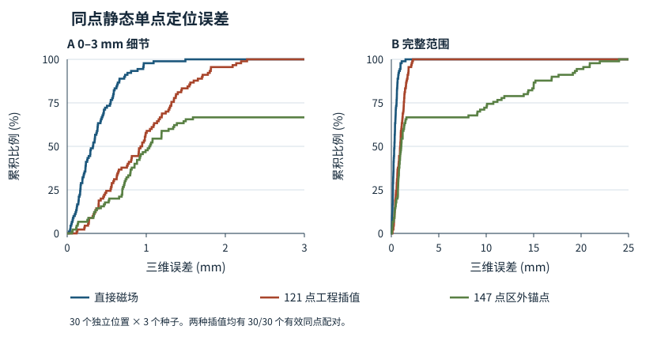
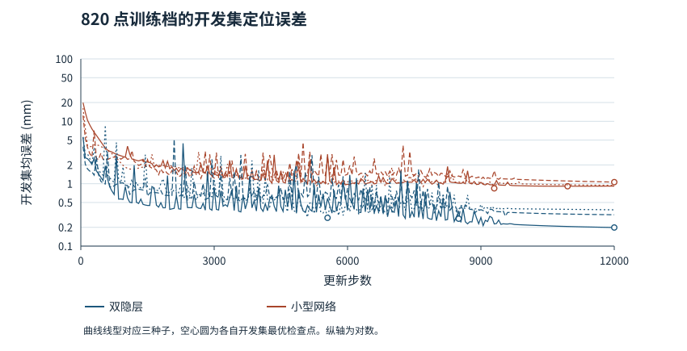
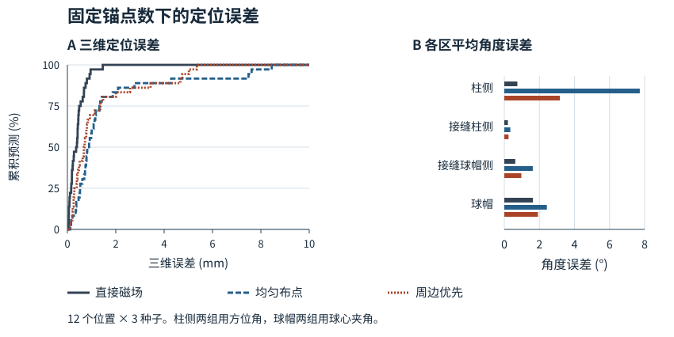
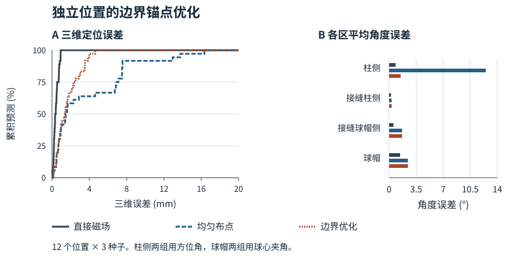
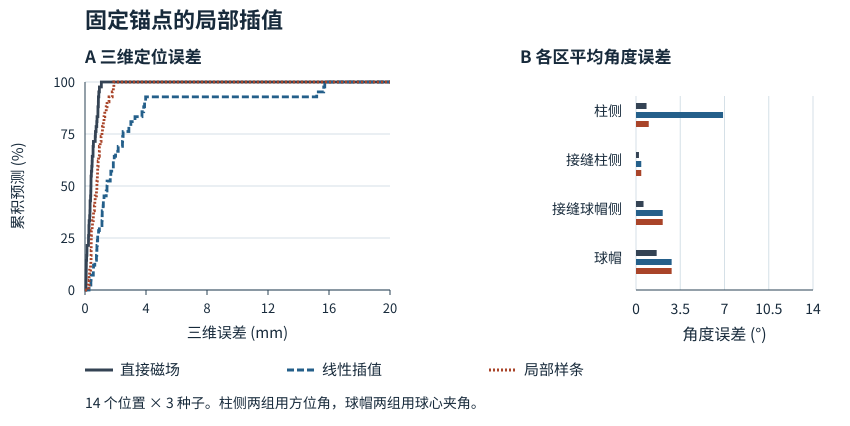

# 柱–半球磁触觉的单点定位与稀疏磁场重建

## 摘要

采用有限数量的磁场锚点进行曲面触点定位时，误差既来自逆模型，也来自对未采样位置的磁场重建。本文在固定 10 mN 法向合力和 σ=12 mm 的载荷宽度下，建立连续柱–半球壳的弹性–磁场正向模型，以 17 个三轴 Hall 传感器的差分磁场估计三维触点。将定位网络及输入磁场在 30 个独立位置上交叉比较，再以各自独立的配对位置分离等数量锚点布置和插值方法的作用。双隐层模型使用直接场时，三维平均误差、RMSE 和 P95 分别为 0.375、0.463 和 0.929 mm，使用工程插值时 P95 为 1.817 mm，区外锚点插值时为 19.925 mm。保持 147 个锚点预算的边界布点在 12 个新位置将 P95 从 13.142 降至 3.877 mm。在冻结该布点后，局部薄板样条在另一组 14 个新位置将 P95 从 14.633 降至 1.774 mm。10 个柱侧混合带新位置上，定位与磁场均满足预设非劣界，过渡上端恢复线性插值。结果支持在已测试的静态单点仿真条件下分层评价定位网络、场支撑和插值，而锚点覆盖不足仍限制区域外推。

关键词：磁触觉，曲面定位，有限元，周期插值，薄板样条

## 1　引言

软磁触觉利用接触引起的磁体或磁性介质变形，使少量磁传感器可读出连续表面的触碰。力与位置的解耦、柔性磁皮肤的连续读出以及可更换传感表面的跨样件迁移，分别揭示了结构、传感与逆映射之间的关系 [1–3,5–8]。已有半圆柱样机展示了离散接触位置识别 [4]。当传感面扩展为连续柱侧与球帽，逆模型需要在不同曲率和接缝附近从有限磁场观测恢复三维位置。以仿真辅助设计时，有限预算还要求把离散直接求解结果重建为连续磁场输入。只比较逆模型端到端误差，会把识别能力与重建误差混在一起。

本文检验两个问题。第一，在相同位置和磁场输入下，双隐层逆模型相对于小型网络与模板匹配有多大优势，换用插值输入后优势是否保持？第二，在保持锚点数与逆模型不变时，边界布点和局部插值能否改善误差上尾，同时保持接缝与球帽表现？证据来自同点、同载荷、同读数顺序的配对。后续证据按控制的因素归纳，各组新坐标保留独立的分母。

## 2　方法

### 2.1　连续曲面及正向模型

外表面由半径 20 mm、高 100 mm 的柱侧和同半径半球构成，内部参考半径 14 mm。采用冻结的 2.5 mm 内层设计，155 个直径 5 mm、厚 1 mm 的圆片磁体以棋盘极性排列并与弹性体完全黏结。17 个三轴 Hall 读数位置与坐标系固定于底座。曲面网格包含 184,388 个四面体，以混合 P2/P1 离散处理近不可压缩材料。下列正向方程同时规定载荷、位移约束与场信号。

#### 载荷与弹性

在未变形外表面 Γ 上，s 为指定触点，n 为外法向。a(s) 对每个位置重新归一，使合力沿接触轴的投影为 F₀=0.01 N，σ=12 mm。载荷形状定义的是受控数值边界条件。

q 汇集自由节点位移与 155 个磁体的刚体自由度，T 为约束变换，p 为离散体积约束的压力变量。K、B、M 分别为剪切刚度、体积耦合和压力质量矩阵，底部环面固支。已存配置按 E=1 MPa、ν=0.49 的参考材料归一；μ=E/[2(1+ν)]，λ=Eν/[(1+ν)(1−2ν)]。磁体节点采用平移加小转角诱导位移。小应变和小转角是适用条件。

(1)  t(X;s) = −a(s) exp[−‖X−s‖²/(2σ²)] n(X),   ∫Γ t · [−n(s)] dA = F₀.

(2)  [ μK  Bᵀ ; B  −M/λ ] [q ; p] = [Tᵀf ; 0].

#### 磁场观测

在 Hall 位置 Xᵢ，将每个磁体的有限圆柱局部场 b_c 变回全局坐标，再用 Hall 轴变换 Qᵢᵀ 读出三轴。c、R 为磁体中心与旋转，0 表示未加载构型，sⱼ 是棋盘极性符号。叠加假设与基线相减写在同一式中。场量按磁极化强度归一，单位为 µT/T。有限圆柱外场采用数值积分，并在轴近旁使用相应稳定展开 [9]。

(3)  Δbᵢ = Qᵢᵀ Σⱼ sⱼ [Rⱼ b_c(Rⱼᵀ(Xᵢ−cⱼ)) − Rⱼ⁰ b_c((Rⱼ⁰)ᵀ(Xᵢ−cⱼ⁰))].

### 2.2　逆模型、周期插值及评价协议

#### 共同输入与预测目标

一次预测只使用一个静态载荷状态的 51 维有符号差分磁场。按 17 个固定 Hall 传感器的既定顺序，每个传感器依次展开三个局部轴分量。差分取加载场减未加载基线。直接场采用 96 阶积分存档。各插值条件保留相同传感器与通道顺序。三种方法都输出曲面触点的三维笛卡尔坐标，单位为 mm。法向合力固定为 10 mN，载荷宽度固定为 σ=12 mm。触点真值、区域标签和载荷值均不作为推理输入。

#### 小型网络与双隐层网络

小型网络为全连接 51→16→3。16 个 tanh 隐单元经线性层输出三个归一化坐标，共 883 个可训练参数，计入偏置。双隐层网络为全连接 51→64→64→3。两个 64 单元隐层均使用 tanh，末层为三个线性输出，共 7,683 个可训练参数。两者均按训练集通道均值和标准差标准化输入，标准差下限为训练通道最大标准差的 10⁻⁶ 倍。式 (4) 给出共享的标准化与双隐层前向计算。小型网络采用同一标准化，将第一隐层直接连至三维输出。

(4)  x = (Δb−m) ⊘ s_b,   h₁ = tanh(W₁x+b₁),   h₂ = tanh(W₂h₁+b₂).

两种网络使用相同的 820 个训练位置。监督标签是生成该磁场时施加牵引的名义表面点坐标。训练前按式 (5) 将 XYZ 转换为无量纲标签，使用偏置 d=(0,0,60) mm 和尺度 D=diag(20,20,60) mm。损失为全部训练位置上三个归一化坐标残差平方的均值。坐标缩放使同样 1 mm 的轴向残差在损失中的权重为横向残差的 1/9。损失直接作用于线性输出，曲面投影不参与反向传播。评价时先反归一化成毫米坐标，再从柱侧和球帽候选投影中选欧氏距离较小者。报告的定位误差在投影后以毫米计算。

(5)  g(b) = ΠΣ[d + D(W₃h₂+b₃)],   L = (3N)⁻¹ Σᵢ ‖fθ(xᵢ)−D⁻¹(sᵢ−d)‖².

#### 训练与检查点选择

每种网络用三个预先固定的随机种子独立训练。权重采用零均值高斯初始化，标准差为 sqrt[2/(输入宽度＋输出宽度)]，偏置初始为零。采用全批量 Adam [11]，β₁=0.9、β₂=0.999、ε=10⁻⁸，共 12,000 次更新。前 6,000 步学习率为 0.008，随后余弦衰减至 0.0008。每 50 步在 17 个开发位置上计算投影后的三维定位误差，以柱侧、接缝、球帽三组均误的等权平均选择每个种子的检查点。区域标签仅用于开发集分组。冻结检查点后才评价独立位置。两种网络同时改变深度和宽度，因此结果反映整体网络配置差异。

#### 余弦模板匹配

模板库由同一 820 个训练位置的直接场及对应坐标组成，每个位置一条模板。查询场和模板场都按各自的 L2 范数归一化。按式 (6) 选择余弦相似度最大的模板，直接返回该模板的已知曲面坐标。该方法使用标签建立磁场到坐标的查找库。它无可训练权重，无梯度训练损失。余弦相似度是推理时的匹配准则。模板输出限于库内坐标，两个网络可以预测训练网格之间的坐标。

(6)  k = arg maxⱼ [bᵀbⱼ / (‖b‖₂‖bⱼ‖₂)],   ŝ = sₖ.

#### 周期支撑与局部平滑

φ 和 β 用弧度，β 从球帽顶轴量起。周期 Delaunay 将周向坐标复制到相邻两周期，在包含查询的三角形内做重心插值。局部样条将最短周向偏移与轴向偏移除以第 12 近邻距离得到 ξ，P 为仿射基，Y 为 51 通道数据，η=0.05，r=0 处取 ψ=0 [10]。

混合权重在低柱侧取 1，在 z≥65 mm 取 0；查询恰好落在已存锚点时保留该锚点场。过渡函数本身在两端的一阶导数为零。该性质只消除权重端点的额外斜率项，近邻集合切换和 Delaunay 三角形边界仍可能改变导数。

(7)  u = Rφ modulo 2πR,   v = z (cylinder),   v = H + R(π/2−β) (cap).

(8)  b_D = Σₖ wₖ bₖ,   Σₖ wₖ = 1,   wₖ ≥ 0.

(9)  (Φ+ηI)A+PC = Y,   PᵀA = 0,   Φᵢⱼ = ψ(‖ξᵢ−ξⱼ‖),   ψ(r)=r² log r.

(10)  b̃ = b_D + α(z)(b_TPS−b_D),   α=1−3t²+2t³,   t=clip[(z−35)/30,0,1].

#### 场误差传播

同点配对的误差增量满足反三角不等式。在投影和网络映射可微、且输入扰动未使结果跳至其他分支的局部邻域，一级项由逆模型 Jacobian 决定。等大小场误差沿不同方向可造成不同位置误差；有些插值误差也可能恰好抵消已有位置偏差。式 (12) 不给跨接缝的全局误差上界。

(11)  e = ‖g(b)−s‖,   ρ = ‖b̃−b‖/‖b‖,   Δe = ‖g(b̃)−s‖−e.

(12)  |Δe| ≤ ‖g(b̃)−g(b)‖,   g(b+δb)−g(b) = J_g(b)δb + o(‖δb‖).

### 2.3　对照设计与统计

主评价保留 30 个独立位置，分别为柱侧 10、接缝柱侧 5、接缝球帽侧 5、球帽 10。另有历史 17 点作直接场对照。工程插值使用 121 个锚点，在周期方位角与区域纵向坐标（柱侧高度或球帽极角）上作双线性插值，共享极点与接缝锚点。严格留区时，只有权重非零的网格锚点全部来自允许位置，该查询才有合法配对。区外锚点方案另用 147 个区外锚点，仍检查每个位置的有效支撑。锚点场可参与构建工程插值器，各测试位置的直接场只用作评价或同点参照。

布点与插值研究先以开发集确定候选，再在不同位置验证。第一组等数量对照比较均匀与周边优先布点。边界富集布局以 4 个低位边界锚点替换 4 个均匀锚点，检验低位柱侧尾部误差和其余分区退化。固定这个 147 锚点布局后，在低位柱侧用局部薄板样条，并按式 (10) 在柱侧 35–65 mm 混合为周期 Delaunay。独立样条对照与两个经线的混合带确认使用新坐标。混合带的确认门为完整配对、总体 P95 增幅≤0.25 mm、平均相对场误差相对增幅≤10%，以及 z≥65 mm 逐值等于 Delaunay。混合带采用几何去重后的新坐标，在锚点支撑内核验。已评价的独立场不回流选点或选模。

三维定位误差为预测与参考接触点间的欧氏距离。方位角误差使用模 360° 后的最小角差，球帽极角误差和柱侧轴向误差按适用区域分别报告。P95、均值、RMSE 和最大值均由实际预测计算。定位网络的各组值按三个种子汇总，模板每点输出一次。配对平均变化的重采样以位置为单位，先对种子求均值，避免把三个种子当作三个独立空间样本。

## 3　结果

### 3.1　逆模型与磁场输入的交叉对照

表 1 汇总了三种逆模型与三种有支撑的输入。图 1 比较双隐层模型在同点的误差累积分布，图 2 给出相同训练量下的开发集误差。双隐层直接场的最大误差为 1.495 mm，历史 17 点直接场平均误差和 P95 分别为 0.407 和 0.974 mm。小型网络与模板的直接场 RMSE 分别为 1.213 和 13.845 mm。两个网络的宽度与深度同时不同，差距属于整体模型配置。双隐层在三种输入下均有更低的平均误差，但在区外重建下仍有显著的上尾误差。

严格留区下，原工程网格的合法配对为 0/30，说明该网格在排除留区内锚点后无法为这些位置提供合法网格支撑。使用另设的区外锚点，双隐层虽可完成配对，最大误差仍为 24.001 mm。工程场输入下，接缝附近球帽侧的 5 个位置共 15 次预测，其中 7 次跨到柱侧，同点直接场为 0/15。跨缝错判与局部场重建退化相符。

表 1　同一 30 个独立位置的逆模型与磁场输入消融。每格为均误 / RMSE / P95，单位 mm。

| 磁场输入 | 小型网络均值 / RMSE / P95 | 双隐层均值 / RMSE / P95 | 模板均值 / RMSE / P95 |
|---|---:|---:|---:|
| 直接场 | 0.983 / 1.213 / 2.288 | 0.375 / 0.463 / 0.929 | 11.034 / 13.845 / 29.778 |
| 工程插值 | 2.041 / 2.625 / 5.560 | 0.963 / 1.096 / 1.817 | 11.298 / 13.961 / 29.778 |
| 区外锚点插值 | 7.213 / 10.703 / 24.032 | 5.474 / 8.983 / 19.925 | 10.498 / 13.147 / 25.871 |

相对于同点直接场，双隐层模型的工程插值平均误差增量为 0.588 [0.426, 0.757] mm，区外锚点插值为 5.098 [2.662, 7.809] mm。括号是 95% 描述性百分位 bootstrap 区间。先在每个位置内对三个种子求均值，再以位置为单位对 30 个位置抽样 5000 次。它描述该测试布点的误差变化，不能直接推广到整张曲面。

图 1　同点定位误差分布。30 个位置及三个模型种子，比较三种磁场输入。

图 2　开发集定位曲线。两种网络使用相同的 820 个训练位置。

### 3.2　有限预算下的锚点布置与场重建

表 2 把等预算布点、固定布局换插值和混合带检验放在同一比较框架。每行都是本组位置上的配对。图 3–5 展示前三行的分布和分区误差。周边优先布点降低总体尾部误差，但接缝柱侧均误从 0.903 升至 0.987 mm。边界富集布局将另一组 12 点中低位柱侧的 P95 从 14.919 降至 3.906 mm。该组接缝柱侧三维与经线方向距离均误分别为 0.872 与 0.819 mm，与均匀布局一致。接缝球帽侧和球帽也满足采用条件。

固定边界富集布局后，薄板样条进一步改善新 14 点的三维误差上尾。该组总体均误由 2.658 降至 0.825 mm，最大值由 15.723 降至 1.892 mm，平均相对场误差由 12.81% 降至 5.29%，保持接缝和球帽预测一致。过渡区新 10 点的平均相对场误差从 3.28% 降至 2.23%，方位角 P95 从 1.207° 降至 1.182°，轴向均误从 1.026 降至 0.781 mm。z=67.5 mm 的两个新位置逐值恢复 Delaunay。z=56.5 和 62.5 mm 的四点仍有轴向偏差，样条定位 P95 为 1.900 mm，直接场为 0.761 mm。

表 2　固定逆模型的各独立场重建对照。P95 单位为 mm。

| 对照 | 位置 / 预测 | 基准 → 候选 P95 | 直接场 P95 |
|---|---:|---:|---:|
| 周边优先布点 | 12 / 36 | 7.521 → 4.820 | 0.928 |
| 边界富集布点 | 12 / 36 | 13.142 → 3.877 | 0.918 |
| 固定布局局部样条 | 14 / 42 | 14.633 → 1.774 | 0.905 |
| 柱侧混合带 | 10 / 30 | 1.834 → 1.748 | 0.704 |

图 3　等数量布点对照。12 个测试位置，36 次预测。B 为分区角度均误。

图 4　边界富集布点。另一组 12 个位置，固定 147 个锚点。

图 5　固定锚点的局部样条对照。14 个位置和 42 次预测。

### 3.3　误差随空间支撑变化的解释

低位柱侧处于锚点支撑边缘。用相同数量的锚点缩小边界间距，可减少查询对较远锚点的依赖。固定该布局后，局部样条同时降低场误差和定位误差，支持重建质量是已测试条件下的重要误差来源。式 (12) 表明场误差的方向也影响逆模型的定位误差，因此相对场误差与位置误差无需逐点单调对应。接缝侧跨面差异体现了这一敏感性。各独立组P95反映各自的空间布点，不能作为同一测试集上的逐级收益相减。

## 4　讨论

本文的直接场结果说明，在固定载荷、理想材料与传感几何下，51 通道差分磁场可支持所测独立位置的毫米及亚毫米定位。与三种输入的交叉比较共同表明，该误差水平依赖场来源。支撑缺失时估计覆盖退化，弱支撑时重建可放大误差。锚点局部加密和薄板样条改善了各自配对组的误差上尾，混合带结果支持在已验坐标平稳退出样条。由于邻域集合与所在三角形可随查询改变，混合权重边界条件不能单独保证整张曲面连续可微。

### 4.1　磁触觉文献中的位置

样机文献表明磁触觉能用于曲面离散定位、平面连续定位及跨样件感知。下表列出原研究的任务与量纲，辅助界定本文的贡献。不同几何、载荷、空间分割和评价量纲对应不同问题，横向比较应关注验证设计和适用条件。

| 工作 | 证据与任务 | 原文指标或检验 |
|---|---|---|
| 本文 | 柱—半球仿真，固定载荷，30 个空间独立位置 | 直接场三维均值 0.375 mm，RMSE 0.463 mm，P95 0.929 mm |
| Mohammadi 等 [4] | 半圆柱软介质样机，离散位置分类 | 2 mm、6 mm 触头各 92%、96%，混合触头 93% |
| Hellebrekers 等 [5] | 磁粉硅胶样机，平面网格/圆形位置分类 | 分类准确率 >98%，回归报告局部面积指标 |
| Hu 等 [6] | 大面积平面磁皮肤样机，4×4 taxel | 平均定位误差 1.2 mm，面积 48,400 mm² |
| ReSkin、AnySkin [3,7] | 可更换样机与跨实例迁移 | 验证不同样件的适用性或任务迁移 |
| eFlesh [8] | 可压缩晶格样机，时间划分与新样件检验 | 同一实例验证平面 RMSE 0.5 mm，深度 RMSE 0.16 mm |

### 4.2　适用范围与复现

所有结论基于线弹性参考硅胶、无制造误差的几何、理想磁体与固定 10 mN、σ12 mm 下的静态单点仿真。有限的独立位置与三种子无法确定整个表面的总体尾部。在超出锚点支撑的区域，本文提供覆盖失败和区外重建误差的实证。变载荷、任意触头、动态多点、材料校准和实测噪声的影响须用各自实验检验。项目归档保留有限元网格、载荷和场求解设置、逐位置数据划分、模型权重及同点配对结果，可用于复核所报告指标。作者、单位、经费和声明由作者填写。

## 5　结论

在所测静态单点条件下，双隐层模型以直接场实现 0.375 mm 三维均误和 0.929 mm P95。锚点布置与局部重建决定稀疏磁场能在多大程度上保留该性能。在不增添 147 锚点预算、维持同一逆模型的条件下，边界富集和薄板样条在相应独立组中降低了误差上尾，混合带结果支持在所测坐标使用该方案。严格留区的支撑缺口说明，曲面定位性能应同时报告有效覆盖和覆盖内定位误差。

## 参考文献

1. Wang H, et al. Design Methodology for Magnetic Field-Based Soft Tri-Axis Tactile Sensors. *Sensors*, 2016, 16(10), 1356. https://doi.org/10.3390/s16091356

2. Hellebrekers T, et al. Soft Magnetic Tactile Skin for Continuous Force and Location Estimation using Neural Networks. *IEEE Robotics and Automation Letters*, 2020, 5(3), 3892–3898. https://publications.ri.cmu.edu/soft-magnetic-tactile-skin-for-continuous-force-and-location-estimation-using-neural-networks

3. Bhirangi R, et al. ReSkin: versatile, replaceable, lasting tactile skins. *PMLR*, 2022, 164, 587–597. https://proceedings.mlr.press/v164/bhirangi22a.html

4. Mohammadi A, Xu Y, Tan Y, Choong P, Oetomo D. Magnetic-based soft tactile sensors with deformable continuous force transfer medium for resolving contact locations in robotic grasping and manipulation. Sensors, 2019, 19(22), 4925. https://doi.org/10.3390/s19224925

5. Hellebrekers T, Kroemer O, Majidi C. Soft magnetic skin for continuous deformation sensing. Advanced Intelligent Systems, 2019, 1(4), 1900025. https://doi.org/10.1002/aisy.201900025

6. Hu H, Zhang C, Lai X, et al. Large-area magnetic skin for multi-point and multi-scale tactile sensing with super-resolution. npj Flexible Electronics, 2024, 8, 42. https://doi.org/10.1038/s41528-024-00325-z

7. Bhirangi R, Pattabiraman V, Erciyes E, et al. AnySkin: Plug-and-play skin sensing for robotic touch. CoRL, 2024. https://arxiv.org/abs/2409.08276

8. Pattabiraman V, et al. eFlesh: Highly customizable magnetic touch sensing using cut-cell microstructures. arXiv, 2025, 2506.09994. https://arxiv.org/abs/2506.09994

9. Derby N, Olbert S. Cylindrical magnets and ideal solenoids. American Journal of Physics, 2010, 78(3), 229–235. https://doi.org/10.1119/1.3256157

10. Duchon J. Splines minimizing rotation-invariant semi-norms in Sobolev spaces. In: Constructive Theory of Functions of Several Variables, 1977, 85–100. https://doi.org/10.1007/BFb0086566

11. Kingma DP, Ba J. Adam: A method for stochastic optimization. ICLR, 2015. https://arxiv.org/abs/1412.6980
